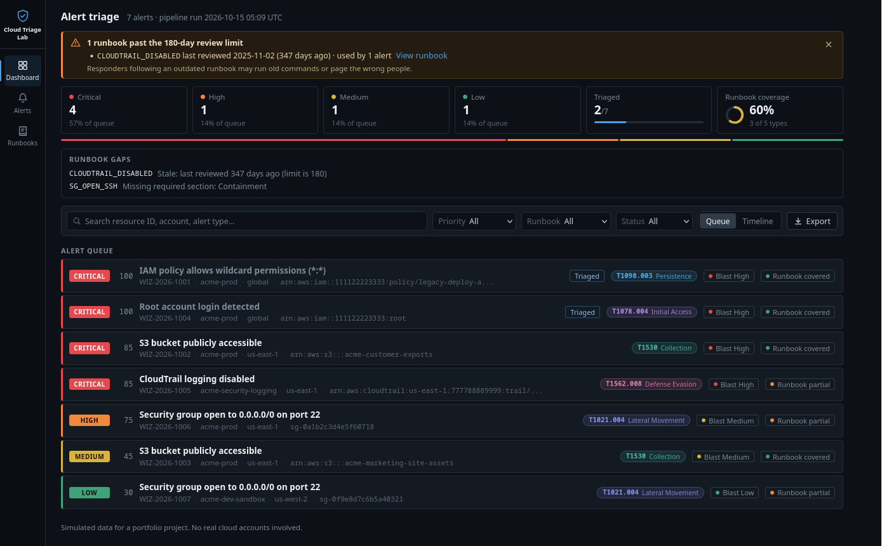

# cloud triage lab



this is a little lab i built to practice the kind of work a cloud incident response analyst does every day. if you work with a tool like wiz, alerts come in all day long and somebody has to figure out which ones actually matter, what to do about them, and whether the team even has instructions written down for handling them. i wanted to really understand that whole flow, so i made my own small version of it that runs on my laptop.

everything in here is fake. the aws account numbers, the buckets, the ip addresses, all of it is made up, so nothing ever touches a real cloud account. all you need is python and flask.

## the alerts

the lab has five types of alerts that show up a lot in real aws environments.

an iam policy that hands out wildcard permissions (`*:*`), which basically makes whoever has it an admin over the whole account.

an s3 bucket that anyone on the internet can read.

somebody logging in with the root account.

cloudtrail logging getting turned off.

a security group that lets anyone in the world try to ssh in on port 22.

there are seven alerts total because i gave a couple of the types two alerts each. that way you can see how the same kind of alert can end up with a totally different priority depending on where it lives.

## how it works

when you run `main.py` it goes through four steps in order and saves the results to a report file.

**alerts** is where the raw alerts live as json files. each one has the stuff a real alert would have, like the alert id, the type, the severity, the resource, the account, the region, and who owns it.

**enrichment** adds context to every alert. it looks the resource up in a fake asset inventory to find out if it's in production or a sandbox, what kind of data it touches, whether it's open to the internet, and what else is connected to it. then it figures out the blast radius, which is basically how much damage someone could do if they abused this. it also tags each alert with the mitre att&ck technique it matches.

**scorer** takes the severity the tool gave the alert and adjusts it using that context. a public bucket full of customer data goes up, a sandbox account goes down, and a bucket that's supposed to be public for the company website drops way down. it writes out the reasons for every point it adds or takes away, so you can always see why an alert ended up where it did. then it sorts everything from critical to low.

**validator** checks the runbooks. for every alert type it makes sure a runbook exists, that it has all the sections a responder would need (overview, triage, containment, remediation, escalation), and that somebody has reviewed it in the last 180 days. i left two problems in on purpose so it has something to catch. the ssh runbook is missing its containment section and the cloudtrail one hasn't been looked at in almost a year.

**runbooks** has the actual response guides, one markdown file per alert type.

**dashboard** is a flask web app for working through everything. the main page shows the stats, a warning banner for stale runbooks, and the alert queue. you can search and filter, open up any alert to see all the context, mark it as triaged with your own notes, switch to a timeline view, read the runbooks right in the page, and export the whole session as json or a pdf. there's also a runbooks page that shows which ones are good and which ones need work.

**tests** has unit tests for all of it, written with python's built in unittest so there's nothing extra to install.

## running it

```
pip install flask
python main.py
python main.py --serve
```

the first command installs flask. the second one runs the pipeline and prints the triage queue in the terminal. the third one does the same thing and then starts the dashboard at http://127.0.0.1:5000

to run the tests use `python -m unittest discover tests`

## what i learned

the biggest thing was that the severity a tool gives you is just a starting point. two public s3 buckets can come in with the exact same severity, but one has customer records in it and the other has pictures for the marketing website. without context you'd treat them the same, and that's how real problems get buried under noise.

thinking in terms of blast radius changed how i look at alerts. instead of asking how bad is this setting, i started asking what could someone actually reach from here. an admin policy or a root login can touch the whole account. cloudtrail getting turned off is scary for a different reason, because it's often what an attacker does right before the part they don't want anyone to see.

i also learned that runbooks get old just like code does. commands change, people leave, and a runbook nobody has reviewed in a year might send you in the wrong direction at 2am. checking them automatically the same way you'd test code felt like a really useful idea.

making the scores explainable mattered more than i expected. a number by itself isn't very helpful, but a list that says plus twenty for high blast radius and plus five for production is something you can actually defend to your team.

on the coding side i got a lot more comfortable with flask and with keeping things separated. the pipeline does the work and the dashboard just shows it. i made sure analyst notes save to their own file so running the pipeline again doesn't wipe anyone's work. i also had to think about security in my own tool. the runbook viewer turns markdown into html, so it escapes everything first to make sure a runbook can't sneak a script into the page. it's a small thing but it's exactly the kind of thing i'd want to catch in someone else's app.

## what i want to add next

i'd like to support the real export format from wiz instead of my own simplified one, add an investigating status between open and triaged, and add more alert types like exposed access keys and unencrypted databases.
